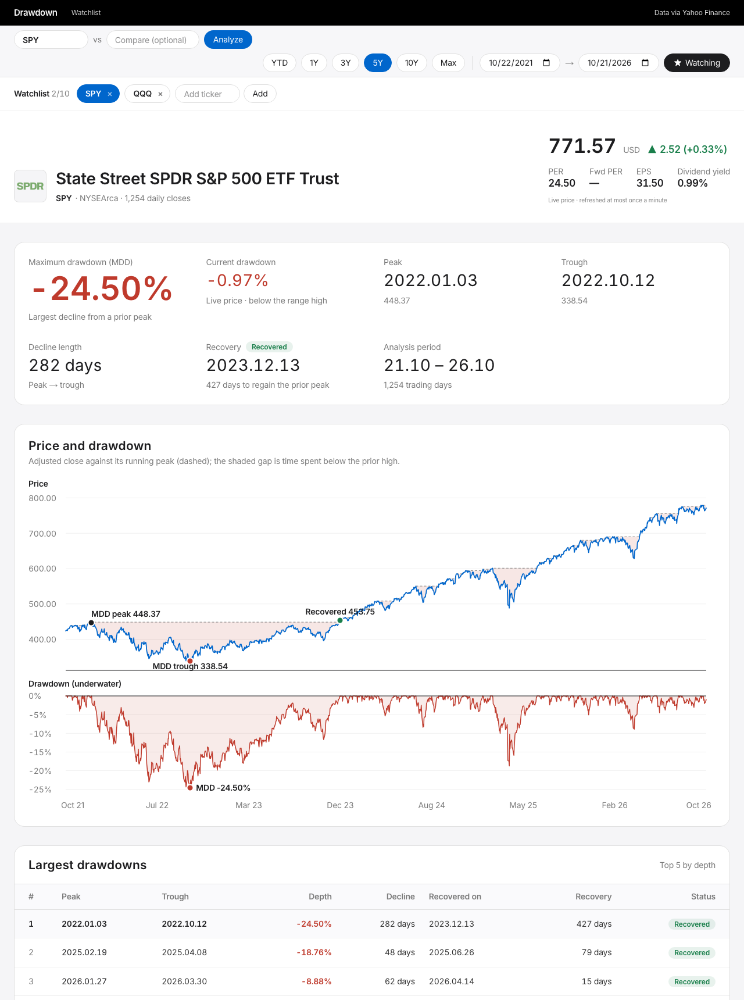
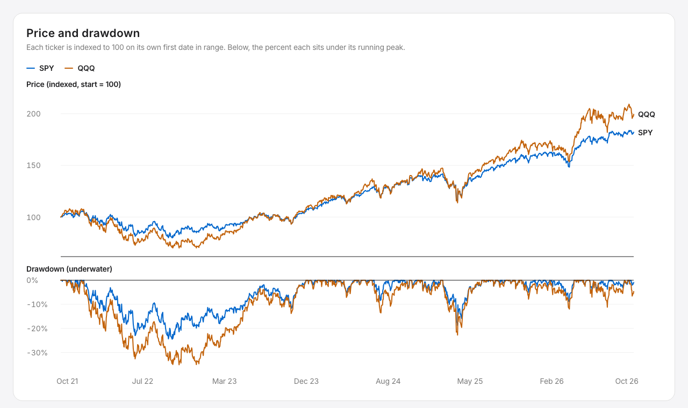
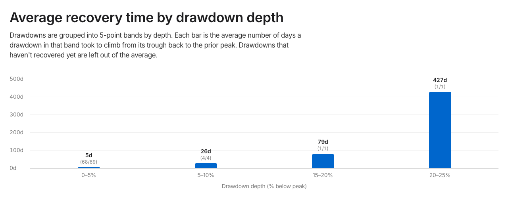
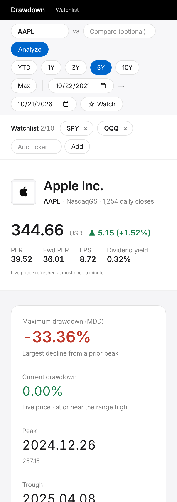
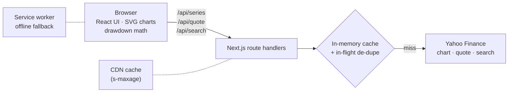

# Drawdown Analyzer

How far did a stock fall, and how long did it take to come back?

Enter a ticker and a date range to see its **maximum drawdown**, every
peak → trough → recovery cycle in that range, and how long recoveries from
drawdowns of a similar depth have historically taken. Add a second ticker to
compare the two side by side.



## Features

- **Maximum drawdown and current drawdown**, measured from the running peak,
  with the peak, trough and recovery dates and how long each leg took.
- **Price and underwater charts** on a shared time axis, with one crosshair
  that reads both. The shaded band is time spent below the prior high.
- **Every drawdown episode**, ranked by depth, with recovery status.
- **Average recovery time by depth**: episodes grouped into 5-point bands,
  with `(recovered/total)` counts shown so a small sample is obvious.
- **Compare mode**: two tickers, prices indexed to 100 on their first day.
- **Live price and fundamentals**: daily change, PER, forward PER, EPS and
  dividend yield.
- **Watchlist** of up to 10 tickers, saved in the browser.
- **Installable on a phone**, with an offline fallback for tickers you've
  already opened.

| Compare mode | Recovery time by depth |
|---|---|
|  |  |



## Run it locally

Requires Node.js 20.9 or newer. There are no API keys, accounts or
environment variables to set up.

```bash
git clone https://github.com/mingeun-shin/mdd-recovery-analyzer.git
cd mdd-recovery-analyzer
npm install
npm run dev
```

Then open <http://localhost:3000>.

| Command | What it does |
|---|---|
| `npm run dev` | Development server |
| `npm test` | Unit tests (Vitest) |
| `npm run typecheck` | TypeScript, no emit |
| `npm run lint` | ESLint |
| `npm run build && npm start` | Production build and server |
| `npm run desktop` | Build and open the desktop app from source |
| `npm run desktop:dist` | Package the desktop app into an installer |

## Desktop app

The same app also runs as a double-click desktop app, with no terminal
window. It's an [Electron](https://www.electronjs.org/) shell that starts the
Next.js server as a hidden background process, opens it in its own window,
and shuts the server down when you quit.

```bash
npm install
npm run desktop:dist
```

The installer lands in `dist-desktop/`: a `.dmg` on macOS, an `.exe` setup
on Windows, an `.AppImage` on Linux. Build on the platform you want to run
it on. On a Mac, open the `.dmg` and drag **Drawdown Analyzer** into
Applications.

The app isn't signed with a paid Apple or Microsoft developer certificate.
One you build yourself opens normally. A copy downloaded from someone else
gets blocked the first time: on macOS, go to System Settings → Privacy &
Security and click **Open Anyway**; on Windows, click **More info → Run
anyway** in the SmartScreen prompt.

## How it works



- **The server only fetches.** Route handlers pull daily adjusted closes
  (1980 to today) and live quotes from Yahoo Finance and return them as
  compact JSON. Full history is fetched once per ticker and sliced to the
  chosen range in the browser, so changing dates never costs a request.
- **The browser does the math.** `lib/analyze.ts` computes the running peak,
  drawdown series, episodes and recovery buckets. It's pure TypeScript with
  no dependencies, which is what makes it straightforward to test.
- **Charts are hand-built SVG**, not a charting library, so the two stacked
  panels can share an x-scale and a crosshair, and the markers and labels can
  avoid colliding with each other.

## Design decisions

**Data source.** Price data comes from the same unauthenticated Yahoo Finance
endpoints its website and the `yfinance` Python library use. It's free and
needs no key, but it's unofficial, and Yahoo returns HTTP 429 when one client
sends too much. Licensed data that may be shown to the public starts at a few
hundred dollars a month, which is why this is a run-it-yourself project and
not a hosted service.

**Caching instead of rate limiting.** Daily closes barely change, so each
layer absorbs repeat requests before they reach Yahoo:

1. Concurrent requests for the same ticker share one upstream call.
2. An in-memory cache holds price history for 30 minutes and quotes for 60
   seconds.
3. The API routes send `s-maxage` headers, so a CDN can serve repeat views
   without running the function at all.

Upstream traffic grows with the number of *distinct tickers* viewed, not the
number of users. An earlier version also kept a shared Postgres cache, which
mattered under a provider's daily quota; Yahoo has none, so it was removed to
keep setup at zero configuration.

**Yahoo's session handshake.** The quote endpoint needs a session cookie plus
a matching "crumb" token. The server gets one pair per instance and refreshes
it on a 401. A plain `Mozilla/5.0` user agent turned out to be necessary: a
full Chrome user-agent string from a non-Chrome client is rejected outright,
because Yahoo compares it with the TLS fingerprint.

**Verifying the math.** The drawdown rules come from a written spec, and
`scripts/spec_reference.py` is an independent plain-Python transcription of
it. The test suite runs the TypeScript implementation against that reference
over 2,500 synthetic trading days, plus hand-built cases for the edge cases
(ties with a prior high, repeated minimums, drawdowns still open at the end
of the data). Writing those tests turned up a bug in the spec itself: its
formula for the number of depth bands dropped any drawdown landing exactly on
a band edge, such as a $100 stock closing at $95. The app fixes it and the
fix is pinned by a regression test.

The test data is synthetic on purpose. Committing real prices would mean
redistributing someone's market data.

## Project structure

```
app/
  analyze/        analysis page (client-rendered from URL state)
  watchlist/      saved tickers with their current drawdown
  api/            series, quote and search route handlers
components/       AnalyzeClient, DrawdownChart, RecoveryChart, WatchlistBar, …
lib/
  analyze.ts      drawdown math and formatting (+ analyze.test.ts)
  quotes.ts       Yahoo client and caches
  watchlist.ts    browser-storage watchlist (useSyncExternalStore)
scripts/
  spec_reference.py   Python reference implementation and fixture generator
public/sw.js      service worker
electron/main.mjs desktop shell: starts the server, opens the window
```

## Tech stack

Next.js 16 (App Router) · React 19 · TypeScript · Tailwind CSS 4 · Electron ·
Vitest · GitHub Actions

## License

The code is [MIT](LICENSE). That covers this repository only, not the market
data the app fetches when you run it.

## Disclaimer

Maximum drawdown is the largest decline from a prior peak during the chosen
period. Results are reference statistics, not investment advice. Market data
comes from Yahoo Finance's unofficial endpoints for personal, educational use
and may be delayed or unavailable.
